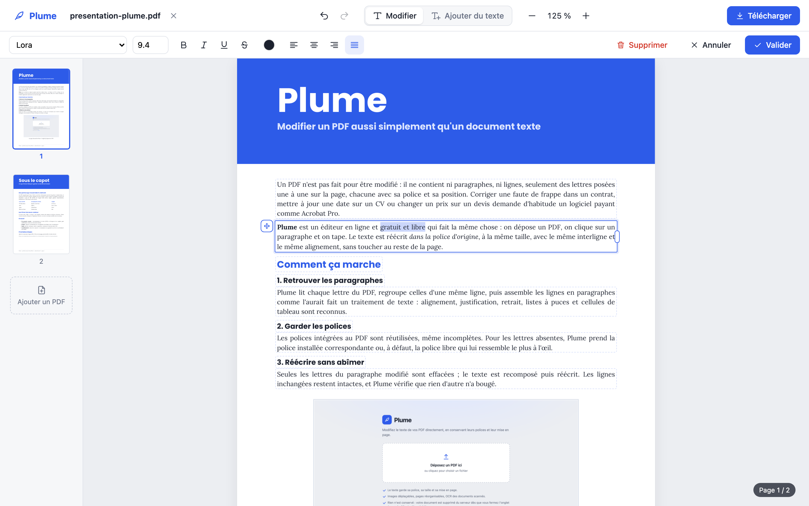
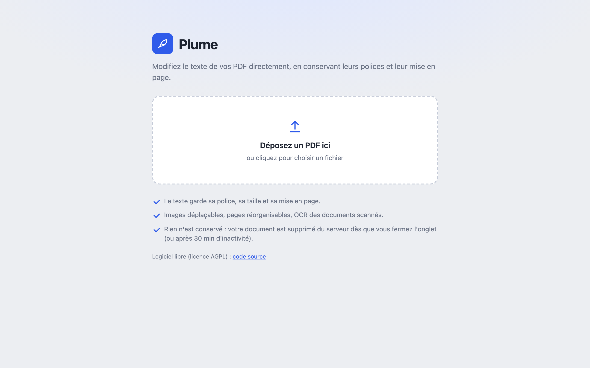
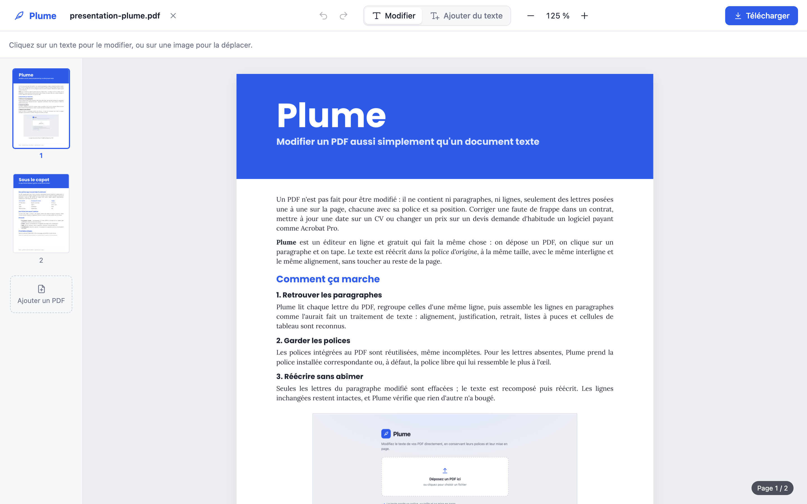
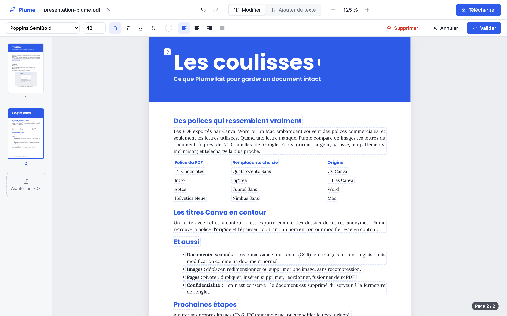
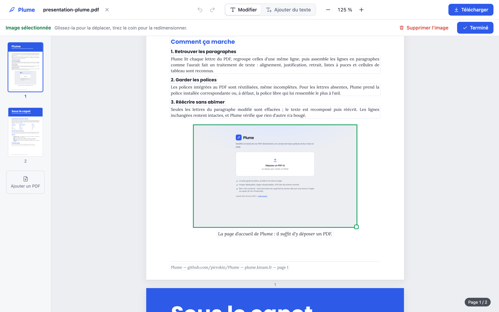

# Plume — éditeur de PDF

Plume permet de **modifier le texte d'un PDF directement**, comme l'outil « Modifier le PDF »
d'Acrobat Pro. On clique sur un paragraphe, on tape, on valide : le texte est réécrit dans la
police d'origine, avec la même taille, le même interligne et le même alignement, sans toucher
au reste de la page.



*Un paragraphe en cours de modification : le texte reste dans sa police (Lora), sa taille et sa
justification. En ligne : <https://plume.kinam.fr>.*

## Fonctionnalités

- **Modification du texte par paragraphe** : le texte se recompose automatiquement (retour à la
  ligne, justification, retrait de première ligne). Les lignes non modifiées restent intactes,
  et un paragraphe recomposé garde les mêmes retours à la ligne que l'original (Word place
  les lettres un peu plus serrées que la police ne le prévoit : la largeur du bloc en tient
  compte).
- **Mise en forme** : police, taille, gras, italique, souligné, barré, couleur, alignement.
- **Blocs** : déplacer, élargir, supprimer un bloc de texte ; ajouter du texte n'importe où.
- **Images** : cliquer sur une image pour la sélectionner, la glisser pour la déplacer, tirer
  son coin pour la redimensionner, `Suppr` pour l'effacer. L'image n'est jamais recompressée.
- **Polices** :
  - réutilisation des polices intégrées au PDF, y compris les sous-ensembles réparés
    (PDF créés sur Mac, Word, Canva…) ;
  - police installée correspondante sinon (Times New Roman, Calibri, Arial…), ou son
    équivalent libre aux mêmes dimensions (Arimo, Tinos, Carlito, Nimbus Sans…) ;
  - téléchargement automatique depuis Google Fonts quand la police est libre ;
  - pour une police commerciale introuvable (Canva, Adobe, Microsoft), les lettres absentes
    sont écrites avec la police libre qui lui **ressemble le plus à l'œil**. Les lettres du PDF
    sont comparées en images (forme, largeur, graisse, empattements, inclinaison) à près de
    700 familles de Google Fonts, et la gagnante est téléchargée à la demande. Exemples :
    TT Chocolates → Quattrocento Sans, Intro → Figtree, Aptos → Funnel Sans,
    Clear Sans → Kedebideri ;
  - polices de titrage (tout en capitales) : une lettre absente s'écrit en capitale.
- **Gros titres Canva** : un texte avec effet « contour » est exporté par Canva comme une police
  Type 3 sans nom. Plume retrouve la police d'origine et l'épaisseur du contour : le titre
  modifié reste en contour, dans sa police. Les copies invisibles du texte (calque de
  sélection) sont effacées avec lui. Un titre sur deux lignes forme un seul paragraphe.
- **Documents numérisés (OCR)** : reconnaissance du texte (français et anglais). La page
  devient consultable et ses paragraphes modifiables : la zone d'origine est repeinte à la
  couleur du papier, puis le nouveau texte est écrit à la couleur de l'encre.
- **Pages** : pivoter, dupliquer, insérer une page blanche, supprimer, réordonner par
  glisser-déposer, ajouter les pages d'un autre PDF.
- **Annuler / rétablir** sur tout l'historique de la session, et téléchargement du PDF final.
  Les polices y sont allégées et ne gardent que les lettres utilisées.
- **Confidentialité** : rien n'est conservé. Un document n'existe que le temps de l'onglet qui
  l'a ouvert. La page envoie un signal toutes les 20 s, et le document est supprimé du serveur
  à la fermeture de l'onglet (après un délai de grâce de 45 s, qui permet de recharger la
  page), après 30 min sans signal, ou au bout de 12 h. Le bouton « Fermer » le supprime
  immédiatement.

## En images

Les captures ci-dessous montrent Plume ouvert sur [`docs/presentation-plume.pdf`](docs/presentation-plume.pdf),
un PDF de présentation du projet (généré par `docs/make_presentation.py`).

| | |
|---|---|
|  |  |
| **Accueil** : on dépose un PDF, rien n'est conservé sur le serveur. | **Document ouvert** : chaque bloc de texte est repéré, les pages se réorganisent dans la colonne de gauche. |
|  |  |
| **Gros titre** : remplacé directement, dans sa police (Poppins SemiBold, 48 pt). | **Image** : sélectionnée, elle se déplace, se redimensionne ou se supprime. |

## Lancer Plume sur son ordinateur

Prérequis : Python 3.11 ou plus récent, et Node.js 18 ou plus récent.

```bash
./plume.sh
```

Puis ouvrir <http://127.0.0.1:8000>. Au premier lancement, le script installe les dépendances
et construit l'interface.

En mode développement, avec rechargement automatique du serveur et de l'interface sur
<http://127.0.0.1:5173> :

```bash
./plume.sh dev
```

Pendant une session, le document et ses versions (une par modification, jusqu'à 60, pour
annuler) sont gardés dans `data/sessions/`, puis supprimés comme décrit plus haut.

## Mise en ligne

### Sur o2switch (hébergement actuel : https://plume.kinam.fr)

Plume tourne comme une application Python du cPanel (Passenger), via `passenger_wsgi.py`.
Pour publier la version locale :

```bash
./deploy/o2switch.sh
```

Le compte SSH se règle dans `deploy/o2switch.env` (fichier non versionné) :

```bash
PLUME_SSH=utilisateur@serveur.o2switch.net
PLUME_SSH_KEY=$HOME/.ssh/ma_cle
```

Le script construit l'interface, envoie les fichiers dans `~/plume-app` par SSH, installe les
dépendances dans l'environnement Python de l'application, la redémarre et vérifie qu'elle
répond.

Mise en place d'origine, faite une seule fois :

- sous-domaine `plume.kinam.fr` (dossier `~/plume.kinam.fr`) ;
- application Python 3.12 (dossier `~/plume-app`, environnement `~/virtualenv/plume-app/3.12`) ;
- certificat HTTPS Let's Encrypt obtenu avec `acme.sh` (`~/.acme.sh`), installé dans le cPanel,
  et renouvelé automatiquement par une tâche cron quotidienne ;
- données temporaires dans `~/plume-data` (sessions, cache, polices téléchargées, modèles OCR).

Particularités d'o2switch prises en compte :

- le pare-feu applicatif (ModSecurity) bloque les envois de fichiers « multipart », donc les
  PDF sont envoyés en corps brut ;
- le serveur frontal rejoue les requêtes qui reçoivent une erreur 5xx, donc Plume répond
  toujours par un code 4xx ;
- plusieurs processus peuvent tourner en parallèle, donc l'état d'un document est relu
  depuis le disque et protégé par un verrou.

### Avec Docker (autre serveur)

La configuration fournie utilise Docker et [Caddy](https://caddyserver.com), qui obtient et
renouvelle tout seul le certificat HTTPS.

1. Sur un serveur (VPS) avec Docker, cloner le projet.
2. Faire pointer le domaine (enregistrement DNS `A`) vers l'adresse IP du serveur.
3. Créer `.env` à partir de `.env.example` et y renseigner `PLUME_DOMAIN` (et éventuellement
   `PLUME_PASSWORD` pour demander un mot de passe).
4. Démarrer avec `docker compose up -d --build`.

## Réglages (variables d'environnement)

| Variable | Défaut | Rôle |
|---|---|---|
| `PLUME_PASSWORD` | *(vide)* | Mot de passe d'accès ; vide = pas de connexion requise |
| `PLUME_DATA_DIR` | `data/` | Sessions, cache, modèles OCR, polices téléchargées |
| `PLUME_SESSION_IDLE_MINUTES` | `30` | Suppression d'un document sans signal de son onglet |
| `PLUME_SESSION_CLOSE_GRACE_SECONDS` | `45` | Délai après la fermeture de l'onglet |
| `PLUME_SESSION_MAX_HOURS` | `12` | Durée de vie maximale d'un document |
| `PLUME_MAX_STORAGE_MB` | `3000` | Espace disque total des sessions (les plus anciennes partent) |
| `PLUME_MAX_UPLOAD_MB` | `100` | Taille maximale d'un PDF envoyé |
| `PLUME_MAX_PAGES` | `500` | Nombre maximal de pages |
| `PLUME_MAX_VERSIONS` | `60` | Versions conservées pour annuler |
| `PLUME_GOOGLE_FONTS` | `1` | `0` pour ne jamais contacter Google Fonts |
| `PLUME_OCR_LANGUAGES` | `fra+eng` | Langues de l'OCR (codes Tesseract) |
| `PLUME_FONT_DIRS` | — | Dossiers de polices supplémentaires (séparés par `:`) |
| `PLUME_SYSTEM_FONTS` | `1` | `0` pour ignorer les polices de l'ordinateur (reproduire un serveur nu) |
| `PLUME_SECRET` | *(généré)* | Clé de signature des sessions |
| `PLUME_COOKIE_SECURE` | `0` | `1` pour forcer les cookies HTTPS derrière un proxy |

## Tests

```bash
cd backend
../.venv/bin/python -m pytest
```

Outils de mise au point (dossier `backend/tools`) :

- `python -m tools.inspect_blocks fichier.pdf 0 sortie.png` dessine les blocs détectés ;
- `python -m tools.try_edit fichier.pdf 0 "début du bloc" "ancien" "nouveau" sortie` fait une
  modification et produit une image avant/après ;
- `python -m tools.sweep ~/Documents` fait des modifications au hasard sur tous les PDF d'un
  dossier, sur des copies en mémoire, et vérifie que le reste des pages ne change pas ;
- `python -m tools.build_lookalikes 700` recalcule `plume/data/lookalikes.bin`, les signatures
  des 700 familles Google Fonts les plus utilisées (quelques minutes, télécharge de petits
  sous-ensembles de chaque police).

## Architecture

- `backend/plume/` : serveur Python ([FastAPI](https://fastapi.tiangolo.com) et
  [PyMuPDF](https://pymupdf.readthedocs.io)) :
  - `extract.py` regroupe le texte en paragraphes et détecte l'alignement et l'interligne ;
  - `layout.py` recompose le texte (coupure des lignes, justification) ;
  - `editor.py` et `writer.py` effacent et réécrivent le texte ;
  - `docfonts.py`, `pdffonts.py`, `fontindex.py` et `googlefonts.py` gèrent les polices ;
    `lookalike.py` compare les polices en images pour trouver la plus ressemblante ;
  - `ocr.py` reconnaît le texte des scans ; `contentstream.py` et `images.py` déplacent les
    images ; `store.py` gère les sessions et les versions ; `app.py` expose l'API HTTP.
- `frontend/` : interface React + TypeScript (Vite). `src/editor/richtext.ts` est l'éditeur de
  texte riche, qui reproduit la mise en page de la page pendant la saisie.

## Limites connues

- Le texte tourné (vertical, en biais) n'est pas encore modifiable.
- Un texte qui s'allonge peut chevaucher le contenu situé dessous, comme dans Acrobat :
  il faut alors élargir ou déplacer le bloc.
- Les polices Type 3 (dessins de lettres) ne sont pas réutilisées telles quelles : le texte
  modifié est écrit dans la police dont elles sont tirées quand le PDF l'indique (titres
  Canva), sinon dans une police générique.
- Quand une police intégrée ne contient pas une lettre et qu'elle n'est disponible nulle part,
  cette lettre est écrite avec une police ressemblante.

## Prochaines étapes

- **Ajout d'images** : insérer une image depuis son ordinateur (PNG et JPG pour commencer),
  la placer sur la page, la redimensionner, puis la déplacer ou la supprimer comme les images
  déjà présentes dans le PDF. L'image serait intégrée telle quelle, sans recompression.
- Modification du texte orienté (vertical, en biais).

## Licence

Plume est distribué sous licence [GNU AGPL v3](LICENSE), comme PyMuPDF sur lequel il repose.
L'instance en ligne étant accessible à tous, son code source est publié ici et la page
d'accueil y renvoie.
